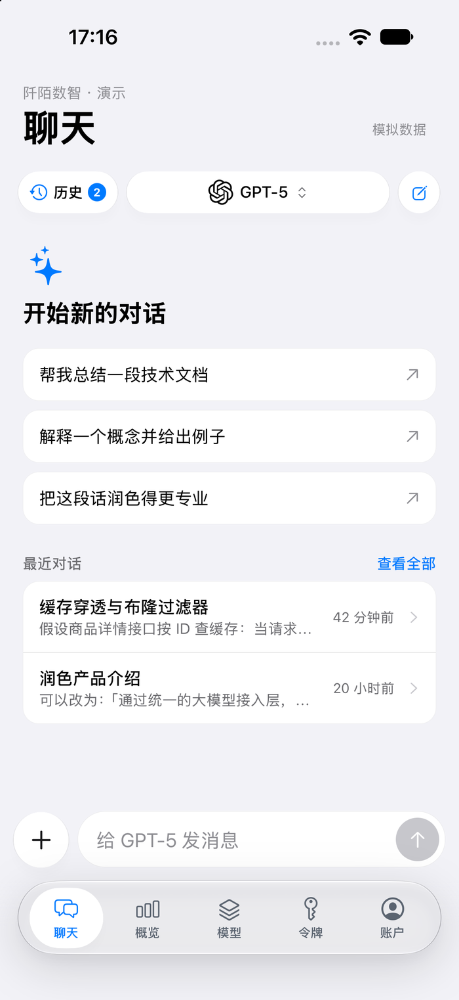
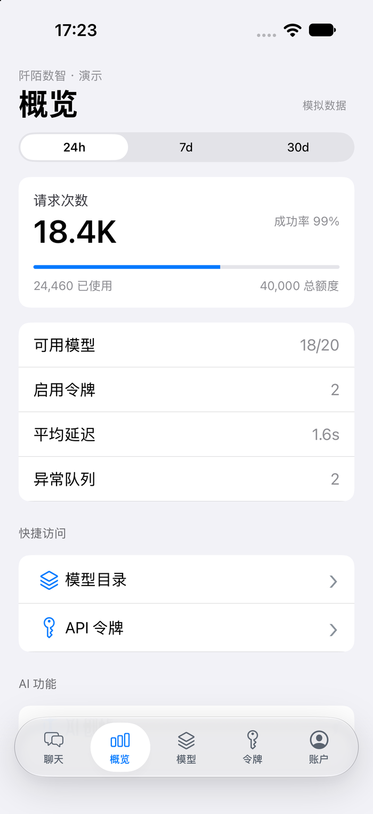
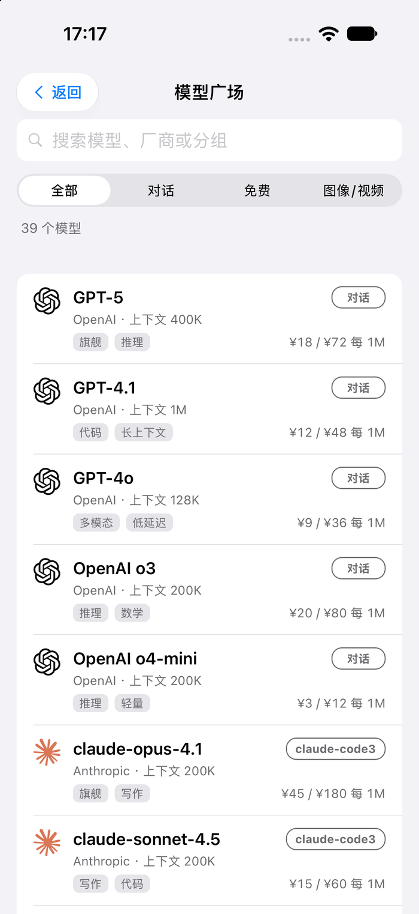
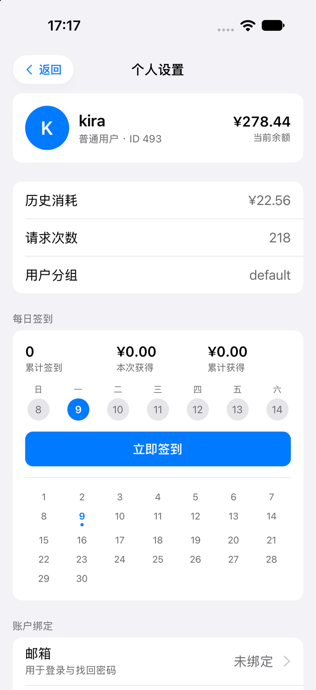
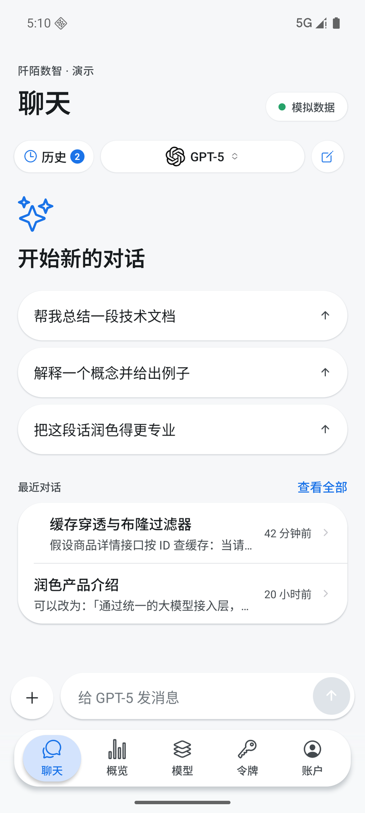
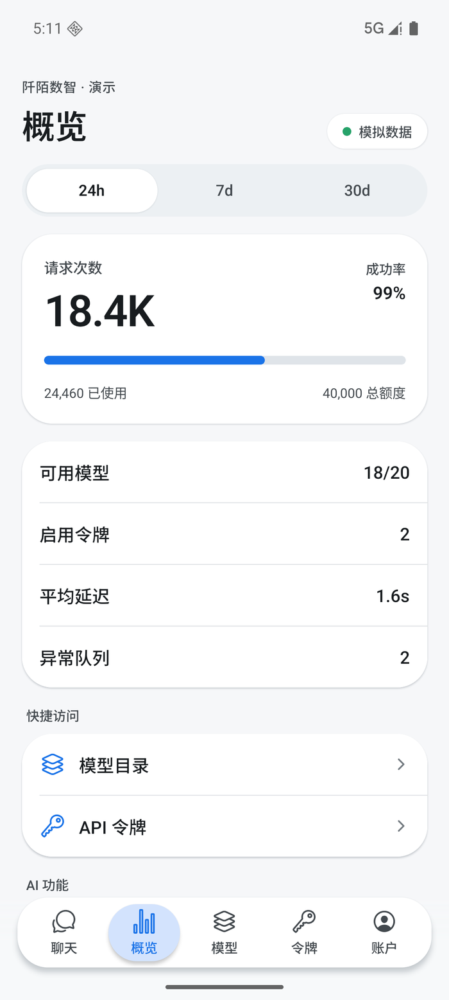
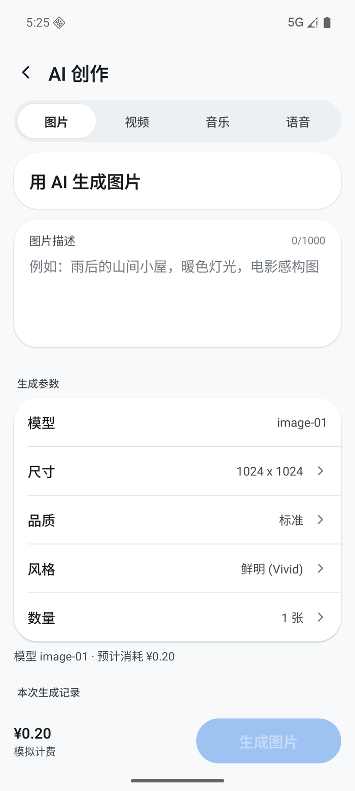
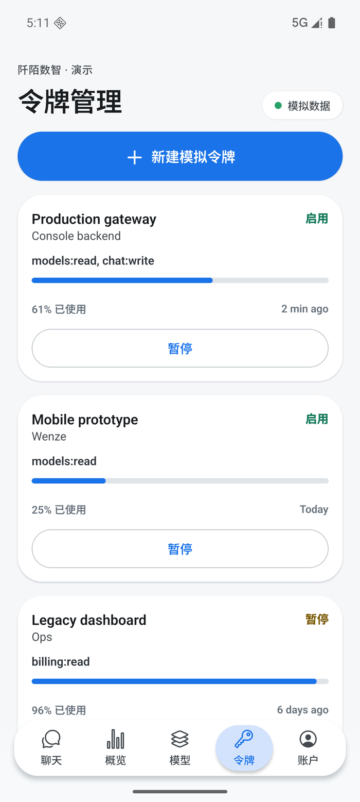

# 阡陌数智 · 移动端

阡陌数智用户控制台的 iOS 和 Android 演示应用，使用 Expo、React Native 和 TypeScript 开发。

目前使用本地模拟数据，尚未接入登录和业务接口。聊天回复、任务结果、用量与余额都用于界面演示，不会调用模型或产生费用。

## 界面预览

**iOS**

<p>
  
  
  
  
</p>

**Android（Material 3）**

<p>
  
  
  
  
</p>

截图为界面预览，部分样式可能与当前代码不同。

## 功能

- 聊天：历史会话、模型切换、建议问题、逐字回复与停止。
- 概览：用量统计、额度和常用功能入口。
- 模型：目录搜索、模型详情、模型广场和体验页面。
- 令牌：新建、编辑、启停和删除。
- 工具：图片、视频、音乐与语音创作表单，以及人脸工具和模型融合。
- 账户：个人设置、钱包演示、用量日志、任务与消息。

这些交互均在本地演示。真实文件上传与生成、登录鉴权、订阅和余额流水尚未实现。管理员端、支付交易和古今图书不在项目范围内。

## 运行

安装 Node.js 和 npm。使用模拟器时，iOS 需要 Xcode，Android 需要 Android Studio；也可以使用兼容当前 Expo SDK 的 Expo Go。

```bash
npm install
npm start
```

按终端提示打开应用。也可以直接启动指定平台：

```bash
npm run ios
npm run android
```

检查类型与导出：

```bash
npm run typecheck
npx expo export --platform ios --platform android
```

## 开发

项目使用 Expo SDK 58、React Native 0.88、React 19 和 TypeScript 6。iOS 使用 SF Symbols 和液态玻璃组件，Android 使用 Material 3 样式。

应用入口在 `App.tsx`，页面在 `src/screens`，聊天界面在 `src/ChatWorkspace.tsx`。模拟数据位于 `src/data/mockConsole.ts`，数据适配层位于 `src/services/consoleAdapter.ts`。

- [功能对照](docs/FEATURE_PARITY.md)
- [接手说明](HANDOVER_NEXT_CLI.md)
- [开发记录](HANDOVER.md)

## 许可

代码使用 [MIT 许可证](LICENSE)。第三方模型名称与标识归各自所有者所有。
